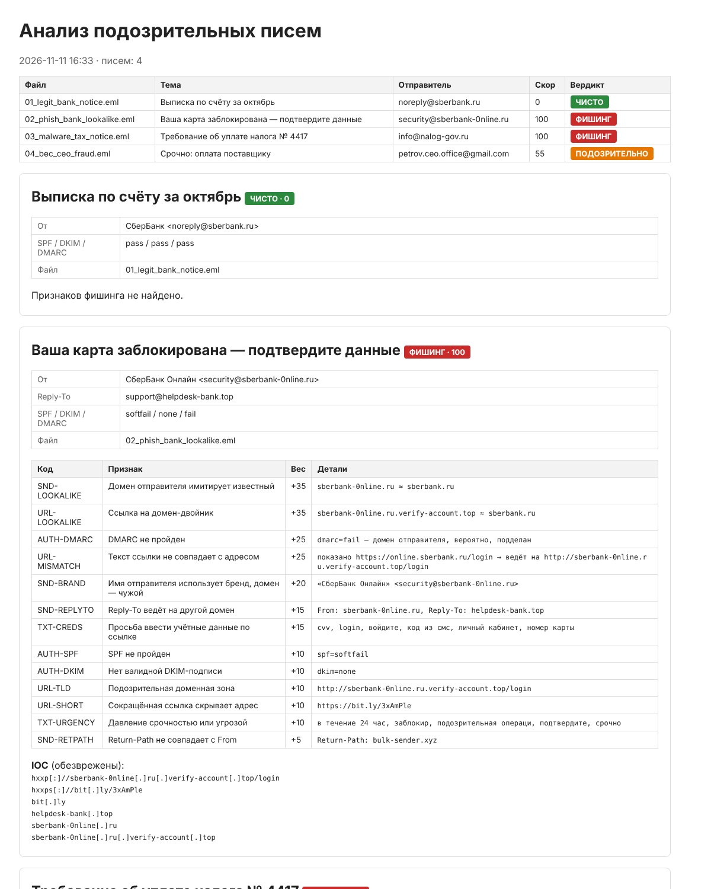

# phish-analyzer — офлайн-анализ фишинговых писем

Инструмент для первой линии SOC: принимает подозрительное письмо в формате `.eml`, за секунду выдаёт вердикт (чисто / подозрительно / фишинг) с перечнем найденных признаков и готовый список IOC в обезвреженном виде (`hxxps[:]//evil[.]com`) для блокировки и обмена. Анализ полностью **офлайн**: ссылки не открываются, вложения не запускаются. Нужна только стандартная библиотека Python; Jinja2 используется для отчёта.



## Результат на демо-письмах

| Письмо | Сценарий | Скор | Вердикт |
| --- | --- | --- | --- |
| 01_legit_bank_notice | Настоящая выписка от банка, SPF/DKIM/DMARC pass | 0 | чисто |
| 02_phish_bank_lookalike | `sberbank-0nline.ru`, ссылка-обманка, bit.ly, «карта заблокирована» | 100 | фишинг |
| 03_malware_tax_notice | «ФНС» с `nalog-gov.ru`, вложение `Требование.pdf.exe` | 100 | фишинг |
| 04_bec_ceo_fraud | «Гендиректор» с Gmail просит срочно оплатить счёт | 55 | подозрительно |

## Что проверяется

| Группа | Признаки |
| --- | --- |
| Аутентификация | SPF fail/softfail, нет DKIM, DMARC fail (из `Authentication-Results`) |
| Отправитель | домен-двойник, punycode, Reply-To и Return-Path на другой домен, чужой адрес в отображаемом имени, бренд в имени при чужом домене, «руководитель» с бесплатной почты (BEC) |
| Ссылки | текст ссылки ≠ реальный адрес, IP вместо домена, сокращатели, подозрительные зоны, `@` в адресе, punycode, домены-двойники |
| Текст | давление срочностью и угрозами, просьба ввести пароль/CVV/код из СМС, просьба об оплате или смене реквизитов (RU + EN) |
| Вложения | двойное расширение (`.pdf.exe`), исполняемые файлы и скрипты, документы с макросами, архивы; SHA-256 и MD5 каждого вложения |

### Поиск доменов-двойников

`lookalike_of()` проверяет домен против списка часто подделываемых (банки, Госуслуги, ФНС, ЦБ, Microsoft…):

- **гомоглифы**: `0→o`, `1→l`, `rn→m`, кириллические `а е о р с` вместо латинских (`sberbank-0nline.ru`, `rnail.ru`);
- **опечатки** — расстояние Левенштейна для длинных брендов (`gosusluqi.ru`);
- **бренд в поддомене или через дефис** (`sberbank.ru.verify-account.top`, `nalog-gov.ru`).

Защита от ложных срабатываний покрыта тестами: `uber.com` не считается двойником `sber.ru`, а `mail.company.ru` — двойником `mail.ru`.

### Вердикт

Скор — сумма весов признаков (максимум 100). Повторяющийся признак, например пять сокращённых ссылок, учитывается один раз. Пороги: **≥ 60 — фишинг, ≥ 30 — подозрительно**.

### IOC

Выгружаются в `iocs.csv` и `report.json`: URL, домены, адреса отправителей, IP из заголовков `Received`, хеши вложений. Официальные домены брендов и публичные почтовые сервисы (gmail.com, mail.ru…) в список доменов не попадают, чтобы их случайно не заблокировали. Для таких отправителей IOC — конкретный адрес.

## Запуск

```bash
pip install -r requirements.txt
python -m phishanalyzer.samples                 # демо-письма в samples/
python -m phishanalyzer.cli samples/*.eml       # анализ → out/report.html, out/report.json, out/iocs.csv
python -m pytest -q                             # 30 тестов
```

Письмо из почтового клиента: «Сохранить как…» → `.eml` (Outlook: перетащить письмо в папку, Thunderbird: «Сохранить как»).

## Безопасность самого инструмента

Содержимое письма контролирует атакующий, поэтому все поля в HTML-отчёте экранируются (Jinja2 `autoescape`), а ссылки выводятся только в обезвреженном виде и не кликабельны.

## Ограничения

- DNS-запросы не выполняются: SPF, DKIM и DMARC берутся из заголовков, которые проставил ваш почтовый сервер.
- Содержимое вложений не анализируется — только тип, имя и хеши. Для глубокого анализа хеш можно проверить в VirusTotal или запустить файл в песочнице.
- BEC-письма без ссылок и вложений распознаются хуже всего (скор 55, а не 100) — здесь нужна проверка по известным адресам руководителей.

## Стек

Python 3.11+ (`email`, `html.parser`, `hashlib`), Jinja2, pytest
